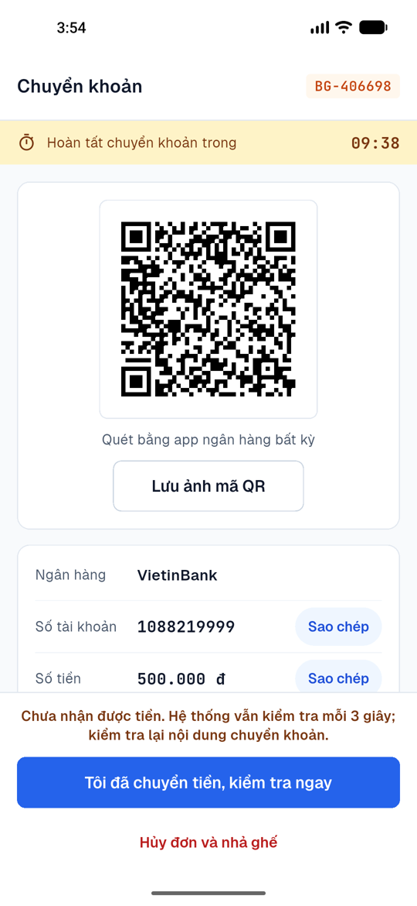
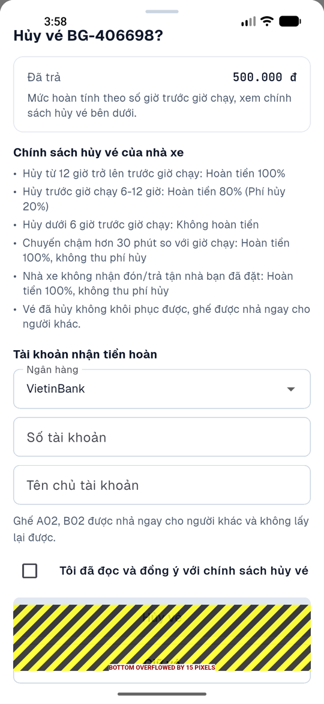
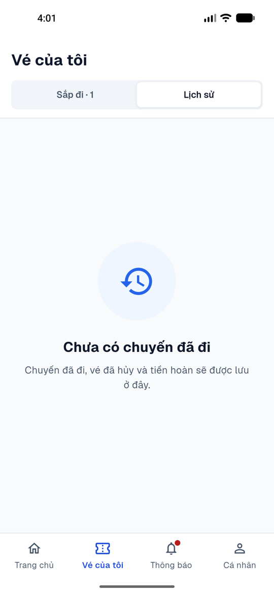
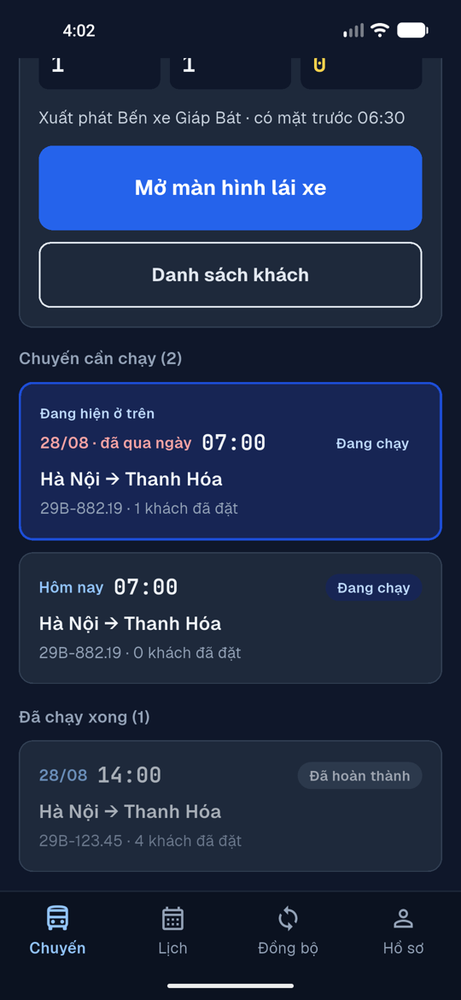
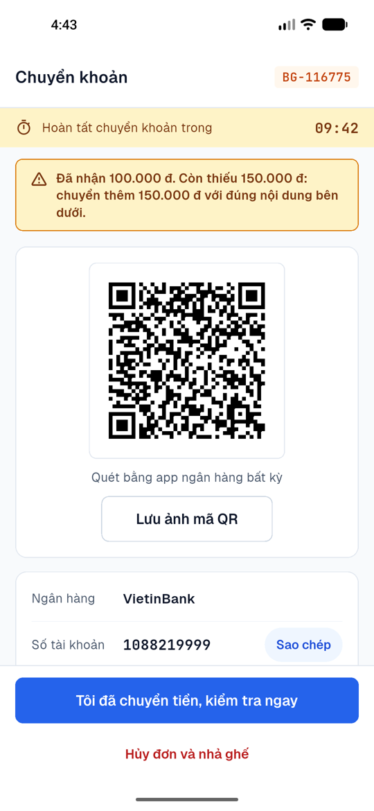
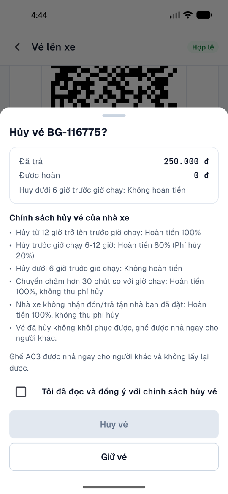
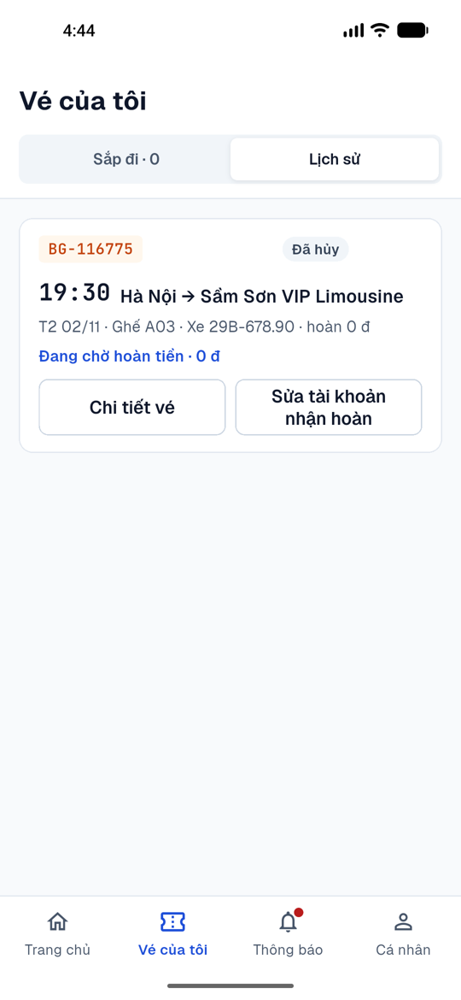
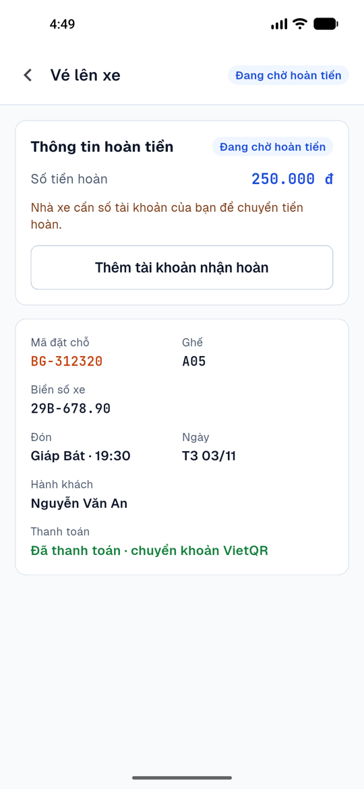
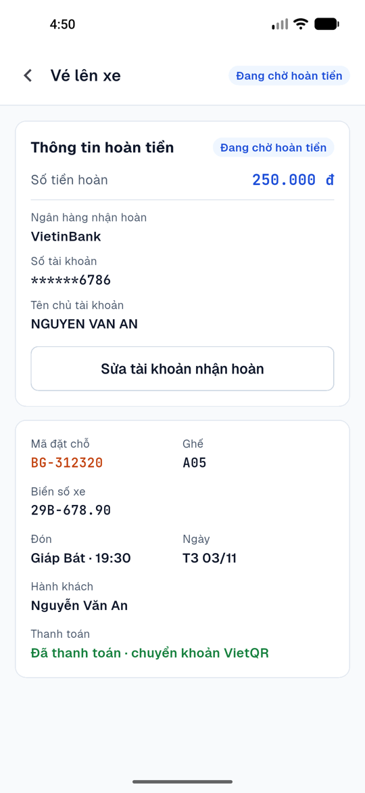
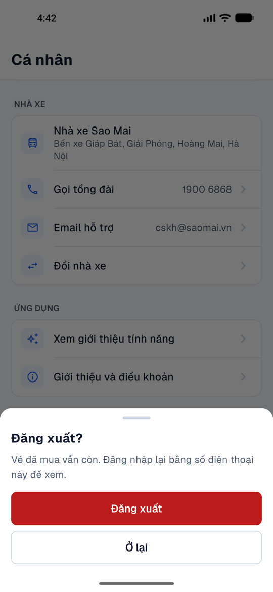

# Lượt thử toàn hệ thống theo tình huống thực tế (02/11/2026)

Đứng ở vai người dùng: hành khách đặt vé trên app (emulator Pixel 5), tài xế TX8821 trên app tài xế, điều hành qua API. Song song, một script giả lập nhiều khách cùng lúc qua API. Server chạy code nhánh này trên cổng riêng, dữ liệu riêng.

## Tình huống đã thử

| # | Tình huống | Kết quả trước khi sửa |
|---|---|---|
| 1 | 10 khách đặt cùng một chuyến, 2 người tranh một ghế | Đúng: chỉ 1 người giữ được, người kia nhận "Ghế vừa có khách khác giữ chỗ" |
| 2 | Khách giữ ghế rồi bỏ, hết 10 phút | Đúng: ghế tự nhả |
| 3 | Quầy bán đúng ghế khách app đang giữ | Đúng: quầy bị từ chối |
| 4 | Quét một QR hai lần | Đúng: "đã lên xe trước đó" |
| 5 | Khách chuyển thiếu (400k/500k) | **Lỗi**: app vẫn báo "Chưa nhận được tiền", số tiền vẫn 500k nên khách dễ chuyển thêm cả 500k |
| 6 | Khách chuyển tiền sau khi hết giữ ghế, ghế đã có người lấy | Server hoàn tiền đúng, nhưng **khách không nhận thông báo nào** |
| 7 | Hủy vé ngay sau khi đặt (từ màn "Đặt vé thành công") | **Lỗi**: không tính được tiền hoàn, vẫn đòi tài khoản ngân hàng dù hoàn 0 đ, nút bị tràn màn hình |
| 8 | Hủy vé dưới 6 giờ (hoàn 0 đ) | **Lỗi**: server tạo yêu cầu hoàn 0 đ cho điều hành xử lý |
| 9 | Nhà xe hủy chuyến có 9 khách | Thông báo đúng, nhưng **vé biến mất khỏi app**: không ở Sắp đi, không ở Lịch sử, không có chỗ nhập tài khoản nhận hoàn; bấm thông báo không mở được gì |
| 10 | Tài xế quên kết thúc chuyến (chuyến 28/08 vẫn "Đang chạy") | **Lỗi**: tài xế vẫn chạy được chuyến khác, 3 chuyến cùng "đang chạy" trên một xe; điều hành không có cách đóng chuyến |
| 11 | Tài xế bấm nhầm chạy chuyến 07:00 ngày mai lúc 16:00 hôm nay | **Lỗi**: server cho chạy; chuyến bị coi là đã xuất bến nên ngừng bán cả tối |
| 12 | Xe hỏng giữa đường, tài xế kết thúc sớm khi còn khách chưa đón | **Lỗi**: khách đã trả tiền vẫn giữ vé "còn hiệu lực", không thông báo, không hoàn tiền, điều hành không được báo |
| 13 | Một số điện thoại đặt "trả tiền mặt khi lên xe" trên 4 chuyến (20 ghế) | **Lỗi**: không giới hạn, giữ chỗ ảo không mất gì |
| 14 | Tìm chuyến sau khi đã bán 6 ghế (chuyến chưa gán xe) | **Lỗi**: vẫn hiện "Còn 34 chỗ" |
| 15 | Cảnh báo "chuyển thiếu" của điều hành sau khi khách trả đủ | **Lỗi**: cảnh báo vẫn còn, ghi "Chưa xuất vé" dù vé đã xuất |
| 16 | Đăng xuất app khách | Đăng xuất ngay, không hỏi lại |

   

## Đã sửa (D189)

Quy tắc chi tiết ở `decision-log.md`, dòng D189. Sau khi sửa:

- Chuyển thiếu: "Đã nhận 100.000 đ. Còn thiếu 150.000 đ…", mã QR đổi sang số còn thiếu (server tạo).
- Hủy vé từ màn đặt thành công: "Được hoàn 0 đ", không đòi tài khoản, không tràn.
- Vé đã hủy hiện ở Lịch sử, mở được từ thông báo, thấy số tiền hoàn và nút "Thêm tài khoản nhận hoàn".
- Tài xế: chạy sớm hơn 60 phút bị từ chối ("Chưa tới giờ chạy… bắt đầu được từ 06:00"); còn chuyến chưa kết thúc thì không chạy chuyến khác ("Chuyến 07:00 ngày 28/08 (biển số 29B-882.19) vẫn đang chạy…").
- Điều hành (giám đốc, điều độ) kết thúc được chuyến bị quên: `POST /api/v1/ops/trips/:id/end`.
- Kết thúc giữa đường: khách chưa đón được hủy vé, hoàn 100% nếu đã trả, có thông báo; điều hành nhận cảnh báo đỏ.
- Tối đa 2 đơn tiền mặt chưa đi cho mỗi người đặt; tìm chuyến hiện đúng số chỗ; cảnh báo chuyển thiếu tự gỡ; tiền về trễ có thông báo; hủy không hoàn không tạo yêu cầu 0 đ; đăng xuất hỏi lại; mọi bottom sheet của app khách tự cuộn khi dài.

     

## Còn lại, chưa làm

- App điều hành chưa có nút "Kết thúc chuyến" và "Hủy chuyến" trên giao diện; mới có API.
- Khách **đã lên xe** khi xe hỏng giữa đường: chưa có luồng chuyển xe hay hoàn một phần.
- Hủy một ghế trong đơn nhiều ghế (một người không đi được): app hủy cả đơn.
- Tìm chuyến tới "BX Phía Bắc Thanh Hóa" vẫn hiện chuyến chỉ trả khách ở Sầm Sơn (tìm theo tỉnh). Cần xác nhận đây có phải ý đồ.
