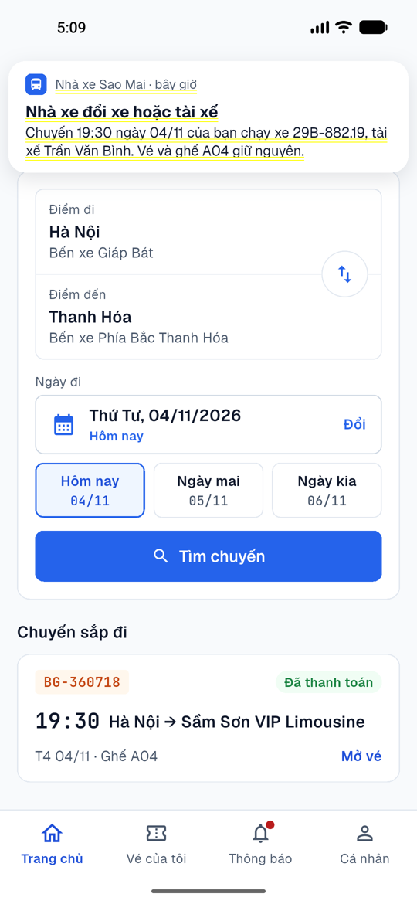
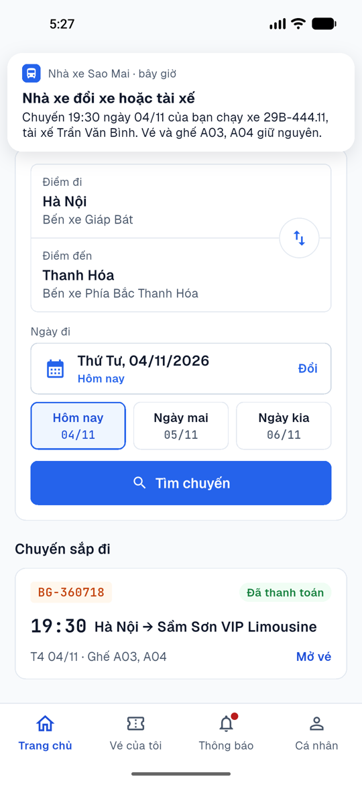
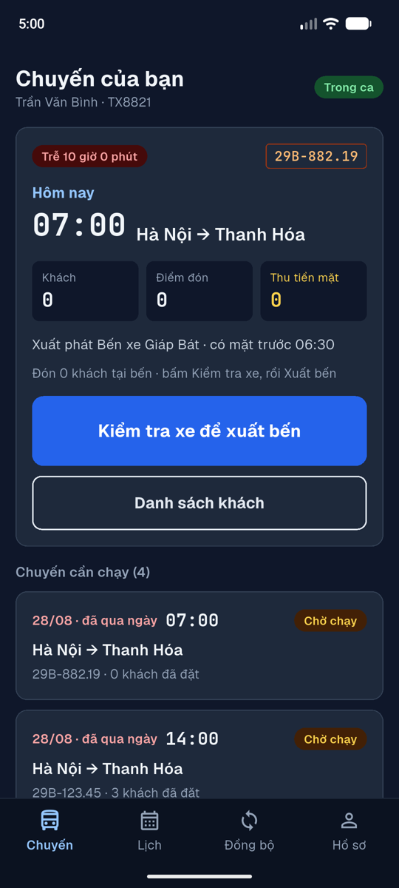
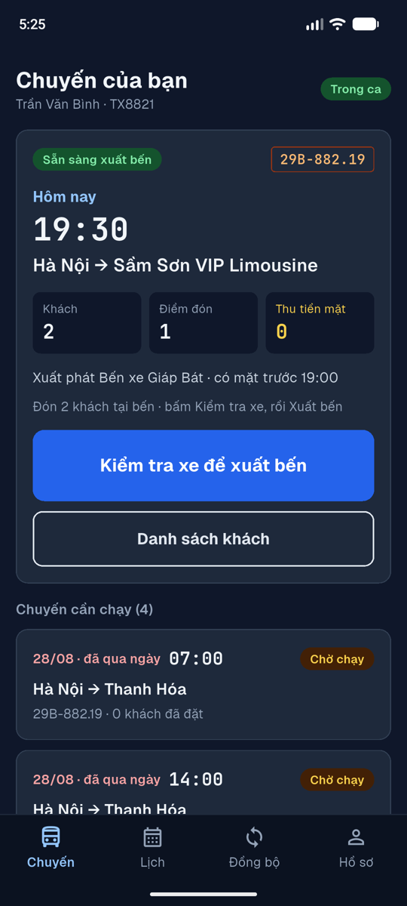
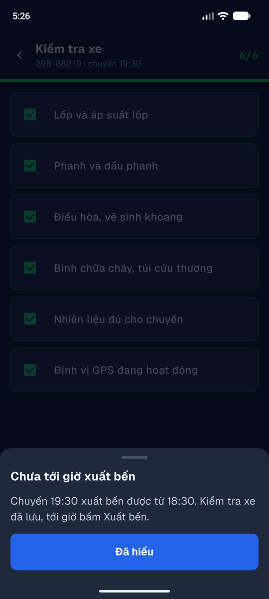
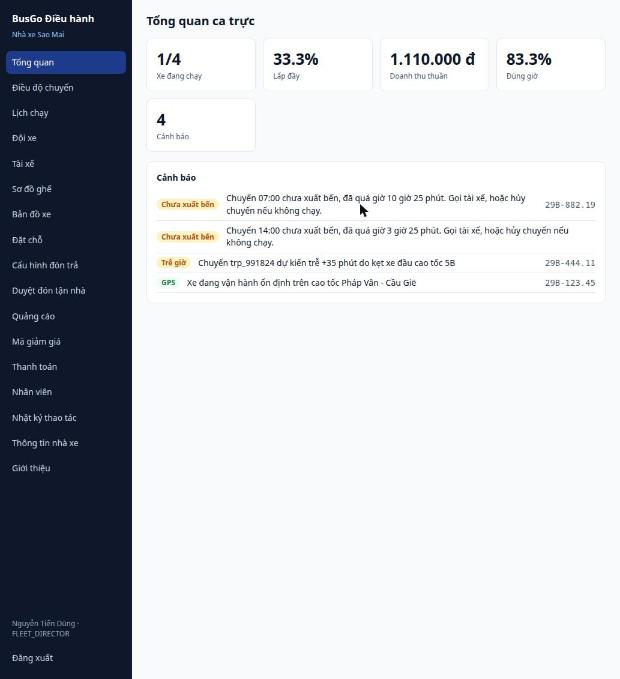

# Lượt thử tay trên máy ảo (04/11/2026)

App khách trên Pixel 5 (emulator), app tài xế trên Pixel 6 (emulator), web điều hành trên Chrome. Server chạy code nhánh này, dữ liệu sạch, cổng riêng. Khách 0978 *** 456 đặt 2 ghế chuyến 19:30 Hà Nội → Sầm Sơn với mã BUSGO50K, chuyển khoản, xem vé, thử hủy một ghế; điều hành gán xe rồi đổi xe; tài xế TX8821 kiểm tra xe và thử xuất bến lúc 17:00.

## Thấy gì, đã sửa gì (D191)

| # | Thấy | Đã sửa |
|---|---|---|
| 1 | Thông báo trong app là banner đẩy header xuống; chỉ "xe sắp tới" mới hiện | Thẻ nổi giống thông báo điện thoại, đè lên trang, tự ẩn, vuốt lên để ẩn; bấm mở đúng màn (xe trên bản đồ, vé, màn báo trễ). Mọi thông báo mới đều hiện |
| 2 | Chuyến chưa gán xe: tìm chuyến ghi "Chưa có biển số xe" nhưng vé ghi 29B-678.90 (biển mẫu) | Vé không có biển số tới khi nhà xe gán xe; gán xong vé tự cập nhật |
| 3 | Đơn 2 ghế nhận 2 thông báo đổi xe giống nhau | Một thông báo cho mỗi khách/đơn: "ghế A03, A04 giữ nguyên" |
| 4 | 17:00, khung lớn của tài xế là chuyến 07:00 trễ 10 giờ, không khách; chuyến 19:30 có khách nằm dưới | Chuyến quá giờ hơn 2 tiếng không chiếm khung lớn khi còn chuyến sắp chạy |
| 5 | Bấm Xuất bến lúc 17:02 cho chuyến 19:30: hỏi quyền, hỏi xác nhận, rồi toast lỗi thoáng qua | Nút ghi "Xuất bến từ 18:30", bấm thì giải thích, không hỏi gì |
| 6 | Điều hành không được báo chuyến 07:00 và 14:00 chưa xuất bến; nhãn cảnh báo là mã tiếng Anh | Cảnh báo "Chưa xuất bến" (đỏ khi có khách), nhãn tiếng Việt, bấm mở chuyến |
| 7 | Bảng điều độ ghi chuyến 19:30 là "Hà Nội — Thanh Hóa (Cao tốc)", app khách và tài xế ghi "Hà Nội — Sầm Sơn VIP Limousine" | Bảng ghi tên của lịch chạy |
| 8 | Bản đồ chuyến Sầm Sơn không có đường nào nối điểm đón và điểm trả | Nét đứt nối các điểm dừng khi chưa có đường vẽ sẵn |
| 9 | Trang chủ "Chuyến sắp đi" ghi "Ghế A04" cho đơn 2 ghế, và lấy vé cuối danh sách | Đơn đi sớm nhất, đủ ghế |
| 10 | Test lịch tài xế cố định tháng 11/2026, hỏng từ hôm nay | Tính theo tháng sau |

Đúng, không cần sửa: giữ ghế 10 phút được kéo theo hạn chuyển khoản; mã giảm giá trừ đúng 50.000 đ; hủy dưới 6 giờ hoàn 0 đ và cho chọn từng ghế; gán xe cập nhật biển số trên vé; server từ chối xuất bến sớm.

     

## Còn lại

- Dữ liệu demo ngày 28/08 vẫn hiện trong danh sách tài xế và tổng quan điều hành ("1/4 xe đang chạy", cảnh báo trp_991824) ngoài production. Đây là dữ liệu mẫu, không sửa.
- Một mã QR cho cả đơn khi mở từ màn đặt thành công, nhưng mở từ ví thì mỗi ghế một vé: giữ như cũ.
